# Quantitative Volatility and Market Risk Analysis — S&P 500 & VIX


An empirical study of volatility and market risk on the S&P 500 from January 2015 to October 2026
(2,975 trading days), built as a small Python package (`volrisk`) and six commented Jupyter notebooks.

It asks how risky the U.S. equity market is, how that risk changes over time, and how well standard
tools (the normal distribution, Value-at-Risk, the VIX) capture it. Results are reproducible from raw
data, key thresholds and windows are fixed in advance, and each method is tied to the academic work it
comes from.

**In one line:** volatility comes in clusters, so a normal model underestimates 99% tail risk by up to
37%, and even the VIX, which looks forward, did not anticipate the 2020 and 2025 shocks.

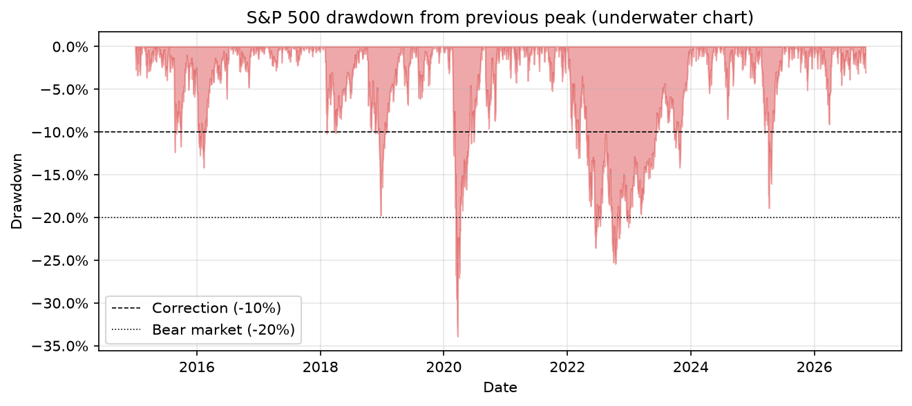

---

## Table of contents

1. [Key findings](#key-findings)
2. [Research questions](#research-questions)
3. [Data](#data)
4. [Repository structure](#repository-structure)
5. [Getting started](#getting-started)
6. [Block 1 — Returns](#block-1--returns)
7. [Block 2 — Volatility](#block-2--volatility)
8. [Block 3 — Distribution and dependence](#block-3--distribution-and-dependence)
9. [Block 4 — Drawdowns and stress periods](#block-4--drawdowns-and-stress-periods)
10. [Block 5 — Value-at-Risk and Expected Shortfall](#block-5--value-at-risk-and-expected-shortfall)
11. [Block 6 — Implied vs. realized volatility (VIX)](#block-6--implied-vs-realized-volatility-vix)
12. [Cross-cutting methodological notes](#cross-cutting-methodological-notes)
13. [Limitations](#limitations)
14. [Possible extensions](#possible-extensions)
15. [References](#references)
16. [Author and disclaimer](#author-and-disclaimer)

---

## Key findings

**Common thread: risk is not constant.** Every tool that assumes constant volatility or normal
returns (normal VaR, square-root-of-time scaling, unconditional forecasts) fails precisely in the
periods that matter most. Each block shows it from a different angle:

| Block | Finding | Evidence |
|---|---|---|
| 1. Returns | The S&P 500 compounded at **11.7% a year** with an annualized volatility of **17.7%**; volatility drag cost about **1.6 points a year**. | CAGR 11.66%; arithmetic mean 12.60% vs. continuous growth rate 11.04%, gap = `σ²/2` = 1.56% |
| 2. Volatility | Volatility is **low most of the time and spikes briefly**. | Median 21-day volatility 12.4%; peak 97.6% in March 2020 |
| 3. Distribution | Returns are **not normal** (negatively skewed, fat-tailed). Their direction is almost unpredictable, but **their size is**: volatility clusters and has long memory. Scaling by past volatility removes about two thirds of the excess kurtosis but makes skewness more negative: **crashes arrive when volatility is low**. | Excess kurtosis 15.9, Jarque-Bera ≈ 31,500 (p ≈ 0); Ljung-Box (20 lags) Q = 289 on returns vs. 4,432 on absolute returns; after scaling, excess kurtosis 5.3 and skewness −0.64 → −1.05 |
| 4. Drawdowns | The maximum drawdown was **−33.9% (COVID-19)**, recovered in 126 trading days; the 2022 bear market was shallower (−25.4%) but took **513 trading days** to recover. | Six episodes ≥ 10% identified with a rule fixed in advance |
| 5. VaR and ES | A normal model **underestimates 99% tail risk** (VaR by 21%, Expected Shortfall by 37%), and **even historical VaR fails the Kupiec backtest at 99%**, because a one-year window adapts too slowly to volatility clusters. | 99% ES 4.59% (historical) vs. 2.91% (normal); 44 (historical, p = 0.003) and 72 (normal) exceedances vs. 27 expected |
| 6. VIX | The VIX **overestimates** realized volatility (variance risk premium) but **forecasts it better** than past volatility. | Bias +3.5 pts; VIX above realized on 82.9% of days; R² 0.35 vs. 0.24 |

---

## Research questions

| Block | Question | Notebook |
|---|---|---|
| 1 | What return and risk did the S&P 500 deliver, and how should returns be measured? | [`01_returns.ipynb`](notebooks/01_returns.ipynb) |
| 2 | How does volatility evolve over time, and does the estimator matter? | [`02_volatility.ipynb`](notebooks/02_volatility.ipynb) |
| 3 | Are returns normal and independent? What do the stylized facts look like on this sample? | [`03_distribution.ipynb`](notebooks/03_distribution.ipynb) |
| 4 | How deep and how long were the market's losses from its peaks? | [`04_drawdowns.ipynb`](notebooks/04_drawdowns.ipynb) |
| 5 | How large are tail losses, and do standard VaR models pass a backtest? | [`05_var_es.ipynb`](notebooks/05_var_es.ipynb) |
| 6 | Does the VIX forecast the volatility that is actually realized? | [`06_vix.ipynb`](notebooks/06_vix.ipynb) |

Each notebook is self-contained: an introduction stating the objective and the choices made, code,
figures, a commentary under each result, and a "key takeaways" section at the end.

---

## Data

### Sources

| Series | Ticker / ID | Source | Role |
|---|---|---|---|
| S&P 500 index (daily OHLC) | `^GSPC` | Yahoo Finance via [`yfinance`](https://github.com/ranaroussi/yfinance) 1.8.0 | Returns, volatility, drawdowns, VaR |
| VIX index (daily OHLC) | `^VIX` | Yahoo Finance via `yfinance` | Cross-check only |
| VIX index (daily close) | `VIXCLS` | [FRED, Federal Reserve Bank of St. Louis](https://fred.stlouisfed.org/series/VIXCLS) (source: Cboe) | **Reference VIX series** for Block 6 |
| VIX history | `VIX_History.csv` | [Cboe](https://www.cboe.com/tradable_products/vix/vix_historical_data/) | Tie-breaker for disputed values |

**Sample:** 2015-01-02 to 2026-10-30, 2,975 S&P 500 trading days (2,974 daily returns).
The download window is set once in [`config.py`](src/volrisk/config.py) (`START = "2015-01-01"`,
`END = "2026-11-01"`, exclusive as in `yfinance`).

### Three-way check of the VIX

Yahoo Finance and FRED agree on 2,977 common dates except three. Two gaps are minor (2021-08-11: 0.11;
2021-10-01: 0.05). The third is not, and the official Cboe history settles it:

| Date | Yahoo Finance | FRED | Cboe (official) | Verdict |
|---|---|---|---|---|
| 2026-02-06 | 20.37 | 17.76 | 17.76 (open 21.24, high 21.49, low 17.27) | Yahoo record wrong: **FRED is used as the reference VIX source** |

The comparison is reproduced by [`scripts/check_vix_fred.py`](scripts/check_vix_fred.py).

**Two things to keep in mind:** `^GSPC` is a **price index** (dividends are excluded), and the data
files are **not redistributed** in this repository (see [Getting started](#getting-started) to rebuild them).

<details>
<summary><b>More details on the data</b> (click to expand)</summary>

<br>

- **Raw data is frozen.** Downloads are saved to `data/raw/` once and never overwritten
  (`save_raw` refuses to overwrite unless `force=True`). All transformations happen downstream.
  A `metadata.txt` file records the download date, the `yfinance` version, the period and the tickers.
- **Structural checks** (`check_raw`): datetime index, sorted, no duplicates, no missing values,
  expected OHLCV columns, first and last dates within one week of the requested bounds
  (1 January is a holiday and 31 October 2026 is a Saturday).
- **Holiday dates.** Since February 2022, Cboe runs Global Trading Hours sessions in S&P 500 and VIX
  options on most U.S. market holidays (SEC Release No. 34-94253). FRED therefore reports VIX values on
  33 days in the sample when the S&P 500 did not trade (Memorial Day, Juneteenth, Independence Day,
  Labor Day, Thanksgiving, Martin Luther King Jr. Day, Presidents' Day and the national day of mourning
  of 9 January 2025), never on Good Friday, Christmas or New Year's Day. These dates are dropped
  when the two series are aligned; this is reported explicitly by `build_forecast_table`.
- **Dividends.** The dividend yield was roughly 1.2–2% a year over the period. Returns, drawdown depths
  and recovery times would all be more favourable on a total-return basis.
- **Closing times.** The VIX closes at 4:15 pm ET, the S&P 500 at 4:00 pm. Since realized volatility in
  Block 6 starts on the next trading day, this 15-minute gap does not create a look-ahead bias.
- **VIX volume.** The VIX volume column is always zero (it is a calculated index) and is never used.
- **No redistribution.** `data/raw/*.csv` and `data/processed/*.csv` are excluded by `.gitignore` in
  line with the data providers' terms; only `data/raw/metadata.txt` is tracked.

</details>

---

## Repository structure

```text
volatility-analysis/
├── data/
│   ├── raw/                     # Frozen raw downloads (CSV files not tracked)
│   │   └── metadata.txt         # Download date, yfinance version, period, tickers
│   └── processed/               # Intermediate files (not tracked)
├── figures/                     # All figures produced by the notebooks (PNG, 150 dpi)
├── notebooks/
│   ├── 01_returns.ipynb
│   ├── 02_volatility.ipynb
│   ├── 03_distribution.ipynb
│   ├── 04_drawdowns.ipynb
│   ├── 05_var_es.ipynb
│   └── 06_vix.ipynb
├── scripts/
│   ├── download_data.py         # Downloads, checks and freezes the raw data
│   └── check_vix_fred.py        # Yahoo vs. FRED VIX comparison
├── src/
│   └── volrisk/                 # Installable analysis package
│       ├── __init__.py
│       ├── config.py            # Single source of settings (paths, tickers, dates, windows, levels)
│       ├── data.py              # Download, validation, storage and loading
│       ├── returns.py           # Simple and log returns, CAGR, summary statistics
│       ├── volatility.py        # Close-to-close, Parkinson and Garman-Klass volatility
│       ├── distribution.py      # Normality test, autocorrelation, Ljung-Box, standardized returns
│       ├── drawdowns.py         # Drawdown series, maximum drawdown, drawdown episodes
│       ├── risk.py              # Historical and normal VaR / ES, rolling VaR, Kupiec test
│       └── vix.py               # Forecast table, error metrics, Mincer-Zarnowitz, variance risk premium
├── tests/                       # Placeholder for unit tests (planned, see Possible extensions)
├── .gitignore                   # Excludes the virtual environment, caches and data files
├── pyproject.toml               # Package definition (pip install -e .)
├── requirements.txt             # Direct dependencies, pinned to the versions used
└── README.md
```

**Design principle:** modules in `src/volrisk/` *compute*, notebooks *present and explain*.
Every function does one thing, has an English docstring (purpose, parameters, returns, raised errors)
and is imported by the notebooks rather than copied into them. All settings live in one place
(`config.py`): `TICKERS`, `START`, `END`, `WINDOWS = [21, 63]`, `CONFIDENCE_LEVELS = [0.95, 0.99]`,
`TRADING_DAYS = 252`.

<details>
<summary><b>Main functions by module</b> (click to expand)</summary>

<br>

| Module | Functions |
|---|---|
| `data` | `download_ticker`, `check_raw`, `save_raw`, `load_raw`, `load_fred_vix` |
| `returns` | `simple_returns`, `log_returns`, `cagr`, `summary_stats` |
| `volatility` | `rolling_volatility`, `parkinson_volatility`, `garman_klass_volatility` |
| `distribution` | `normality_test`, `autocorrelation`, `ljung_box`, `standardized_returns` |
| `drawdowns` | `drawdown_series`, `max_drawdown`, `drawdown_episodes` |
| `risk` | `historical_var`, `historical_es`, `normal_var`, `normal_es`, `rolling_var`, `kupiec_test` |
| `vix` | `realized_future_vol`, `build_forecast_table`, `forecast_errors`, `mincer_zarnowitz`, `variance_risk_premium` |

</details>

---

## Getting started

### 1. Clone and install

```bash
git clone https://github.com/ethn3srf/volatility-analysis.git
cd volatility-analysis

python -m venv .venv
# Windows (PowerShell)
.venv\Scripts\Activate.ps1
# macOS / Linux
source .venv/bin/activate

pip install -r requirements.txt
pip install -e .
```

`requirements.txt` lists the direct dependencies, pinned to the versions used in this project.
`pip install -e .` installs `volrisk` in editable mode, so the notebooks can `import volrisk` and
always use the latest version of the code. The project was developed with Python 3.14.

### 2. Rebuild the data

```bash
python scripts/download_data.py
```

This downloads `^GSPC` and `^VIX`, runs the structural checks and saves the raw files to `data/raw/`.

Then download the FRED VIX series manually:

1. Open <https://fred.stlouisfed.org/series/VIXCLS>, set the range to 2015-01-01 – 2026-10-31 and
   download the CSV.
2. Save it as `data/raw/vixcls_fred.csv`.
3. Optionally, run `python scripts/check_vix_fred.py` to reproduce the Yahoo vs. FRED comparison.

Results may differ marginally if Yahoo Finance revises its historical data after the original
download date recorded in `metadata.txt`.

### 3. Run the analysis

Open the notebooks in order (`01` to `06`) and use **Run All**. Each notebook saves its figures to
`figures/`.

---

## Block 1 — Returns

**Notebook:** [`01_returns.ipynb`](notebooks/01_returns.ipynb) · **Module:** `returns.py`

### Method

- **Simple return** `R_t = P_t / P_(t-1) − 1`: the actual gain or loss of an investor; used for
  performance and for VaR (Block 5).
- **Log return** `r_t = ln(P_t / P_(t-1))`: additive over time, hence used for statistics and volatility.
- **CAGR** `(P_T / P_0)^(365.25 / calendar days) − 1`: the growth rate actually achieved. The arithmetic
  mean of daily returns × 252 overstates it.
- **Annualized volatility**: daily standard deviation × `√252` (square-root-of-time rule, which assumes
  independent returns).

### Results

| Statistic | Value |
|---|---|
| CAGR (price index) | **11.66%** |
| Annualized volatility | **17.65%** |
| Arithmetic mean of simple returns × 252 | 12.60% |
| Continuously compounded growth rate (mean log return × 252) | 11.04% |
| Volatility drag `σ²/2` | 1.56% |
| Skewness (simple / log returns) | −0.36 / −0.64 |
| Excess kurtosis (log returns) | 15.9 |

- **Volatility drag.** The arithmetic mean (12.60%) exceeds the continuous growth rate (11.04%) by
  exactly `σ²/2 = 0.1765² / 2 = 1.56%`: volatility reduces compounded wealth (Booth & Fama, 1992).
- **Stylized facts.** Negative skewness and very fat tails (excess kurtosis 15.9, against 0 for a normal
  distribution) match the stylized facts of asset returns (Mandelbrot, 1963; Cont, 2001).
  Eight of the ten most extreme daily returns occurred between March and June 2020.
- Skewness depends on the definition of returns: taking logs compresses large gains and stretches large
  losses, hence −0.64 for log returns against −0.36 for simple returns.

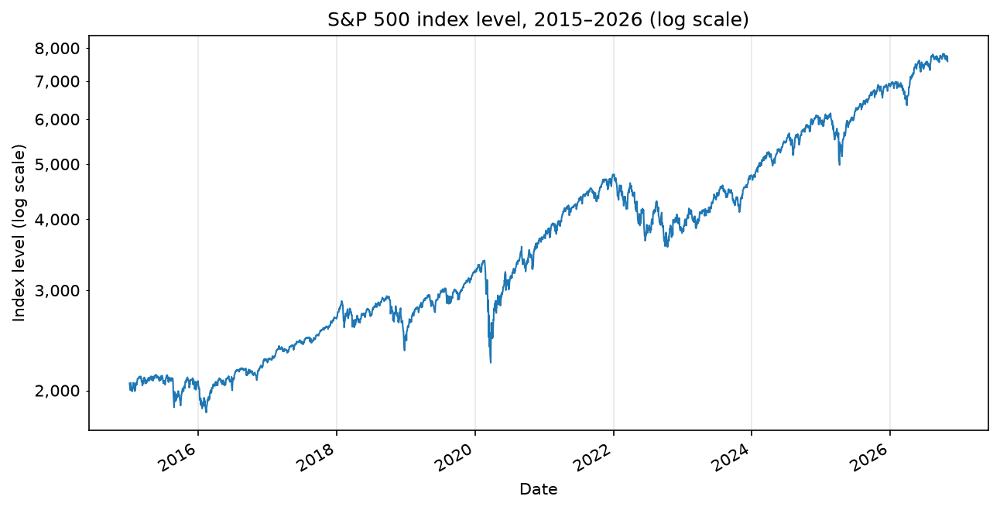
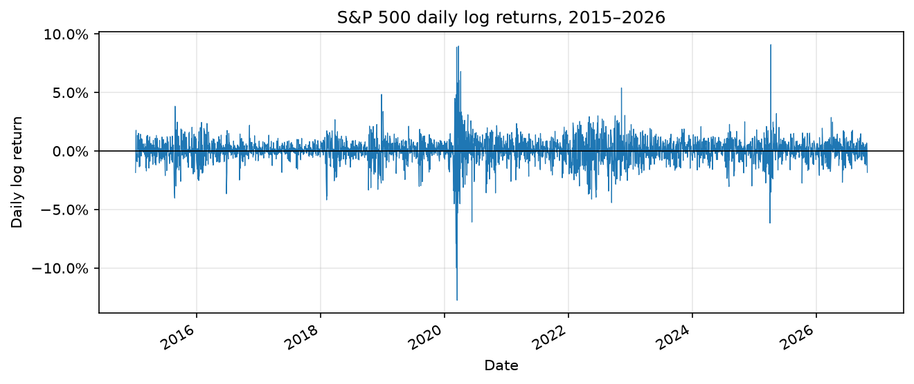

---

## Block 2 — Volatility

**Notebook:** [`02_volatility.ipynb`](notebooks/02_volatility.ipynb) · **Module:** `volatility.py`

### Method

- **Rolling close-to-close volatility** on 21 trading days (one month, reactive but noisy) and
  63 trading days (one quarter, smooth but lagging).
- **Range-based estimators** using daily open, high, low and close prices:
  - Parkinson (1980): `σ² = mean[(ln(H/L))²] / (4 ln 2)`;
  - Garman & Klass (1980): `σ² = mean[0.5 (ln(H/L))² − (2 ln 2 − 1)(ln(C/O))²]`.
- Variances are averaged first and the square root is taken last.
- Close-to-close volatility from daily closes is a *historical* volatility, not the *realized* volatility
  of the high-frequency literature, which uses intraday returns.

### Results

| Statistic (21-day volatility) | Value |
|---|---|
| Median, close-to-close | **12.4%** (Q1 9.3%, Q3 17.9%) |
| Maximum | **97.6%** (March 2020) |
| Median, Parkinson | 9.7% |
| Median, Garman-Klass | 9.4% |

| Year | 2017 | 2020 | 2022 | 2025 | Most other years |
|---|---|---|---|---|---|
| Annualized volatility | ≈ 7% | ≈ 35% | ≈ 24% | ≈ 19% | 12–17% |

- The **median (12.4%) is far below the full-sample volatility (17.65%)**: volatility is low most of the
  time and the average is pulled up by short, extreme episodes.
- **Two types of stress**: *spikes* (2020, 2025), short and violent, and *persistent stress* (2022),
  moderate but lasting a whole year.
- **Leverage effect**: volatility rises when prices fall (Black, 1976; Christie, 1982).
  **Mean reversion**: after each spike, volatility returns toward its long-run level.
- **Range-based estimators are lower** because they ignore the overnight move (close to next open) and
  suffer from a discretization bias (the observed high and low understate the true extremes).
  The Yang & Zhang (2000) estimator addresses both issues and is a natural extension.

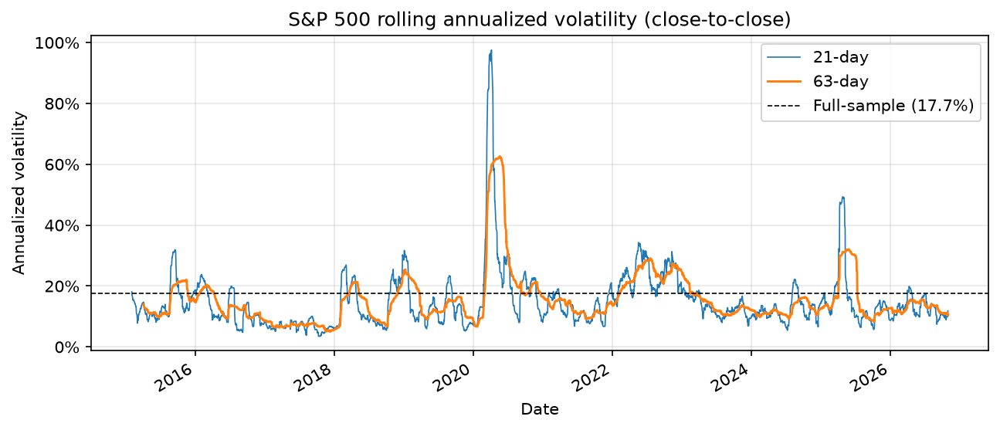
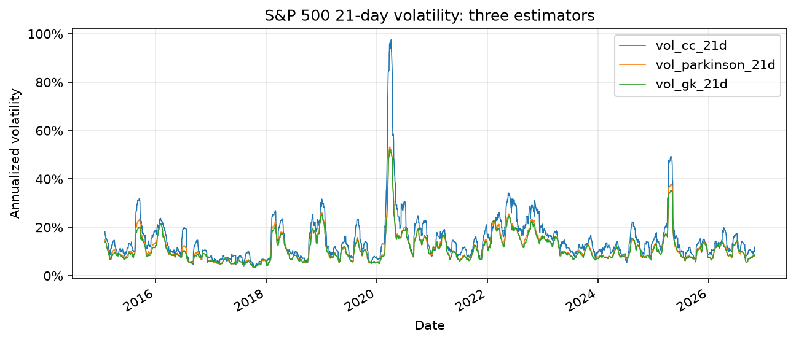
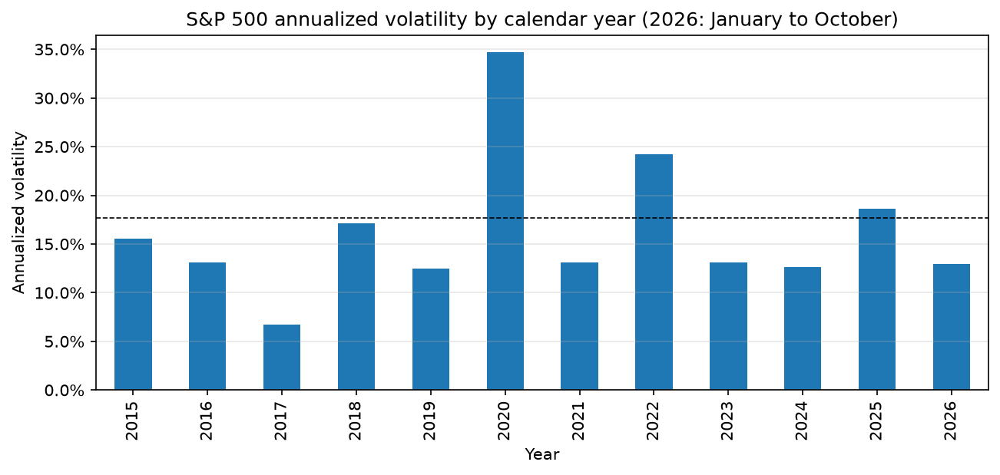

---

## Block 3 — Distribution and dependence

**Notebook:** [`03_distribution.ipynb`](notebooks/03_distribution.ipynb) · **Module:** `distribution.py`

### Method

- **Jarque-Bera test** (Jarque & Bera, 1980): `JB = n/6 × (S² + K²/4)`, where S is the skewness and
  K the excess kurtosis; under normality JB follows a χ²(2).
- **QQ-plot** of empirical quantiles against normal quantiles.
- **Autocorrelation function (ACF)** of returns `r` and of absolute returns `|r|`, with the
  ±1.96/√n confidence band.
- **Ljung-Box test** (Ljung & Box, 1978) on 20 lags: `Q = n(n+2) × Σ ρ_k² / (n−k)`, χ²(20) under the
  null of no autocorrelation. Implemented from scratch and **validated against `statsmodels`**
  (Q = 289.19 vs. 287.91; the 0.4% gap comes from the autocorrelation estimator: pandas uses a Pearson
  correlation on overlapping pairs, statsmodels the standard full-sample ACF).
- **Standardized returns** `z_t = r_t / σ_(t−1)`, where `σ_(t−1)` is the 21-day rolling standard
  deviation known at the close of the previous day (`shift(1)`), to avoid any look-ahead bias.

### Results

| | Raw log returns | Standardized returns |
|---|---|---|
| Skewness | −0.64 | **−1.05** |
| Excess kurtosis | 15.9 | **5.3** |
| Jarque-Bera | ≈ 31,500 (p ≈ 0) | ≈ 4,000 (p ≈ 0) |

| Ljung-Box, 20 lags | Q | p-value |
|---|---|---|
| Returns `r` | 289 | ≈ 1e−49 |
| Absolute returns `abs(r)` | 4,432 | ≈ 0 |
| Standardized returns `z` | 22.3 | **0.33** |
| Absolute standardized returns `abs(z)` | 140 | ≈ 5e−20 |

- **Returns are not normal**, before or after standardization.
- **Volatility clustering**: the ACF of `|r|` is 0.36–0.39 at lags 1–3 and still 0.15–0.18 at lag 20.
  This slow decay is the **long memory** of volatility (Ding, Granger & Engle, 1993), the empirical
  basis of ARCH/GARCH models (Engle, 1982; Bollerslev, 1986).
- **The autocorrelation of raw returns is an artefact of time-varying volatility.** The Ljung-Box test on
  `r` rejects (lag-1 ACF ≈ −0.13, alternating signs during the 2020 crash-and-rebound), but it assumes
  a constant variance. Once returns are standardized, the test no longer rejects (p = 0.33).
- **Standardization removes about two thirds of the excess kurtosis but makes skewness more negative.**
  Crashes tend to arrive after calm periods (low `σ_(t−1)`, so `z` reaches −8), whereas large rebounds
  happen during crises (high `σ_(t−1)`, so `z` stays moderate). Crashes are surprises; rebounds are not.
- `|z|` remains autocorrelated: a 21-day rolling window is a crude volatility model.

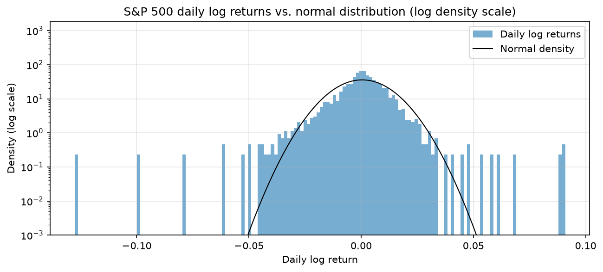
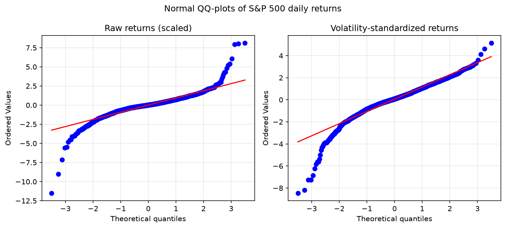
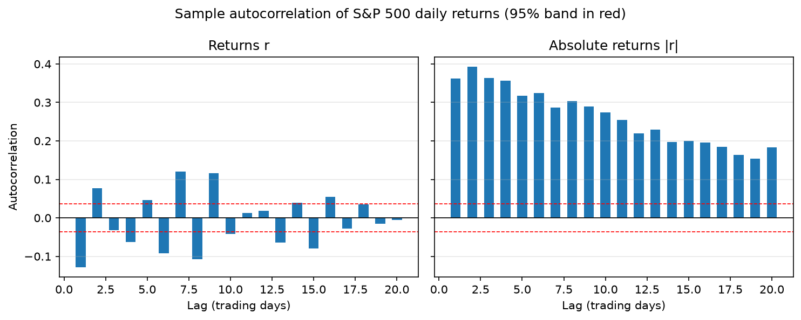

---

## Block 4 — Drawdowns and stress periods

**Notebook:** [`04_drawdowns.ipynb`](notebooks/04_drawdowns.ipynb) · **Module:** `drawdowns.py`

### Method

- **Drawdown** `DD_t = P_t / max(P_s, s ≤ t) − 1`: the loss from the highest level reached so far
  (running maximum, `cummax`).
- **Episode**: the period between a peak and the return to that peak. Durations are counted in trading
  days; an episode not recovered by the end of the sample would be flagged as **censored**.
- **Thresholds fixed in advance** by market convention, before looking at the data: correction ≥ 10%,
  bear market ≥ 20%.
- **Calmar-type ratio**: `CAGR / |maximum drawdown|`.

### Results

| Statistic | Value |
|---|---|
| Maximum drawdown | **−33.92%** on 2020-03-23 |
| Calmar-type ratio | 0.34 |
| Share of days at a new high | 12.7% |
| Share of days at least 10% below the peak | 15.3% |

| Episode | Peak-to-trough decline | Notes |
|---|---|---|
| COVID-19 (2020) | **−33.9%** | Peak 2020-02-19, trough 2020-03-23 after 23 trading days, recovered 2020-08-18 (126 trading days in total) |
| 2022 bear market | **−25.4%** | Peak 2022-01-03, trough 2022-10-12 after 195 trading days, recovered 2024-01-19 (513 trading days in total) |
| Late 2018 | −19.8% | Just short of the 20% bear-market threshold on a closing basis |
| 2025 | −18.9% | 89 trading days from peak to recovery |
| 2015–2016 | −14.2% | 286 trading days from peak to recovery |
| February 2018 | −10.2% | Trough reached in 9 trading days |

- All six episodes were recovered within the sample: **no censored durations**.
- **Depth and duration are two different risks**: COVID was the deepest loss but was recovered in about
  six months; 2022 was shallower but kept investors under water for two years. This mirrors the
  "spike" vs. "persistent stress" distinction of Block 2.
- On a total-return basis (dividends reinvested), recoveries would be faster.


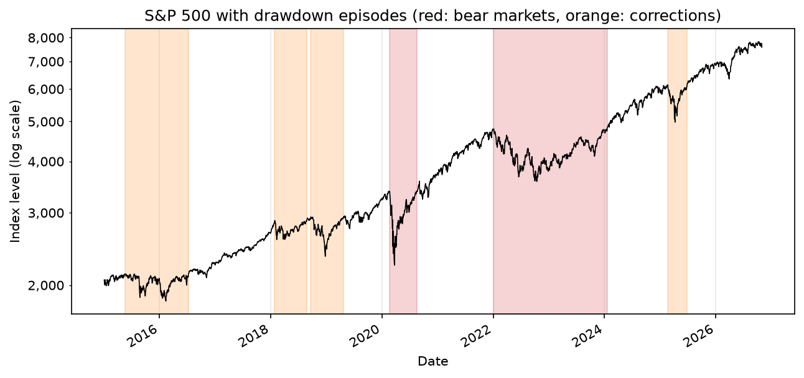

*The underwater chart plots `DD_t`: the surface is the previous peak and the curve shows how far below
it the index stands each day.*

---

## Block 5 — Value-at-Risk and Expected Shortfall

**Notebook:** [`05_var_es.ipynb`](notebooks/05_var_es.ipynb) · **Module:** `risk.py`

### Method

- Losses are expressed as **positive numbers** and computed on **simple returns** (actual losses).
- **Historical VaR**: the empirical quantile of losses; **historical ES**: the average loss beyond the VaR.
- **Normal VaR and ES**: `VaR = −μ − σ z_(1−α)` and `ES = −μ + σ φ(z_α) / (1 − α)`.
- **Rolling backtest**: VaR estimated each day on the previous **252 trading days** (one year, the Basel
  convention), using only information available at the previous close (`shift(1)`).
- **Kupiec (1995) test** of unconditional coverage: likelihood-ratio test that the exceedance rate equals
  `1 − α`, `LR ~ χ²(1)`.
- Expected Shortfall is preferred by regulators because it is a **coherent** risk measure, unlike VaR,
  which is not sub-additive (Artzner, Delbaen, Eber & Heath, 1999). The Basel Committee's FRTB replaced
  the 99% VaR with a **97.5% ES** for market risk capital (BCBS, 2019).

### Results — full sample, one-day horizon

| Level | Historical VaR | Normal VaR | Historical ES | Normal ES |
|---|---|---|---|---|
| 95% | 1.64% | 1.77% | 2.67% | 2.24% |
| 99% | **3.21%** | 2.53% | **4.59%** | 2.91% |

### Results — rolling backtest (2,722 test days)

| Model | Level | Exceedances | Rate | Expected | Kupiec p-value | Verdict |
|---|---|---|---|---|---|---|
| Historical | 95% | 139 | 5.11% | 136 | 0.80 | Not rejected |
| Historical | 99% | 44 | 1.62% | 27 | 0.003 | **Rejected** |
| Normal | 95% | 145 | 5.33% | 136 | 0.44 | Not rejected |
| Normal | 99% | 72 | 2.65% | 27 | < 0.001 (LR = 51.3) | **Rejected** |

- **The normal model crosses the empirical distribution.** It *overestimates* the 95% VaR (the empirical
  distribution has thinner "shoulders") and *underestimates* the 99% VaR by 21% and the 99% ES by 37%
  (fat tails). The error grows with the confidence level and is largest for the ES.
- **At 99%, both models fail**, the normal model by far. Even the historical VaR fails because of
  **volatility clustering**: after a calm year, the one-year window holds no extreme days, so the VaR is
  too low when a crisis begins, and exceedances come in clusters (early 2018, March 2020, 2022, April 2025).
- **Ghost effect**: the historical VaR moves in steps and drops abruptly about 252 days after March 2020,
  when the crash days leave the window, not because risk has changed.
- **Square-root-of-time rule**: the 10-day 99% VaR obtained as `3.21% × √10 = 10.16%` overstates the
  empirical 10-day VaR (9.07%, overlapping 10-day returns). The rule assumes i.i.d. returns; here,
  short-term mean reversion and the aggregation of fat tails reduce 10-day risk. This is not guaranteed
  in a crisis, when clustering can work the other way, and the 10-day estimate is noisy.
- Kupiec only tests the *number* of exceedances, not their *timing*. Christoffersen (1998) tests
  independence as well.

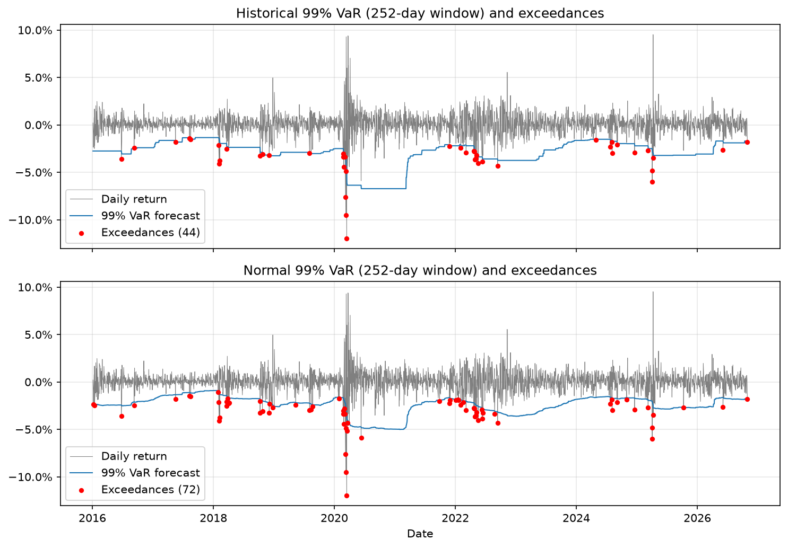

---

## Block 6 — Implied vs. realized volatility (VIX)

**Notebook:** [`06_vix.ipynb`](notebooks/06_vix.ipynb) · **Module:** `vix.py`

### Method

- **Target**: volatility realized over the **next** 21 trading days, `RV(t+1 → t+21)`, annualized
  (`shift(−21)`). The last 21 dates of the sample are dropped because their future is unknown.
- **Forecasts compared** at each date t: the **VIX** (option-implied volatility over the next 30 calendar
  days) and a **naive forecast** (volatility realized over the previous 21 trading days).
- **Error metrics**: bias, mean absolute error (MAE), root mean squared error (RMSE).
- **Mincer-Zarnowitz (1969) regression**: `RV = a + b × forecast + ε`. An unbiased, efficient forecast has
  `a = 0` and `b = 1` (joint Wald test). Consecutive 21-day windows overlap, so residuals are
  autocorrelated: standard errors are **Newey-West (1987) HAC with 21 lags**.
- **Robustness**: the same regressions on **141 month-end observations** (non-overlapping, HAC with 1 lag).
- **Variance risk premium**: `VRP_t = VIX_t² − RV(t+1 → t+21)²` (Carr & Wu, 2009; Bollerslev, Tauchen &
  Zhou, 2009).

### Results (2,933 dates)

| | VIX | Naive forecast | Realized volatility |
|---|---|---|---|
| Mean | 18.32% | 14.84% | 14.81% |
| Median | 16.59% | 12.43% | 12.35% |
| Bias (forecast − realized) | **+3.51 pts** | +0.03 pts | — |
| MAE | 6.18% | **5.72%** | — |
| RMSE | **8.75%** | 9.95% | — |

| Mincer-Zarnowitz | `a` | `b` (s.e.) | R² | Joint test `a = 0, b = 1` |
|---|---|---|---|---|
| VIX, daily | −0.005 | 0.83 (0.11) | **0.35** | Rejected (p < 0.001) |
| Naive, daily | 0.076 | 0.49 (0.09) | 0.24 | Rejected (p < 0.001) |
| VIX, monthly | −0.024 | 0.94 (0.22) | **0.38** | Rejected (p < 0.001) |
| Naive, monthly | 0.080 | 0.46 (0.08) | 0.20 | Rejected (p < 0.001) |

- **The VIX is biased upward**: 18.3% on average vs. 14.8% realized, and above realized volatility on
  **82.9% of days**. This is not a forecasting error but a **price**: the premium investors pay for
  protection against crashes.
- **The VIX's weakness is its level, not its information content.** Taken individually, neither `a = 0`
  nor `b = 1` is rejected (t-statistic for `b = 1`: about −1.5 daily, −0.3 monthly), yet the joint test
  rejects: the estimates of `a` and `b` are strongly negatively correlated, and the fitted line lies about
  3.5 points below the 45° line around the average VIX.
- **The VIX is more informative than past volatility** (R² 0.35 vs. 0.24 daily, 0.38 vs. 0.20 monthly).
- **The naive forecast over-reacts** (`b ≈ 0.5`): volatility is **mean-reverting**, so last month's level
  must be shrunk toward the long-run average.
- **MAE and RMSE rank the forecasts differently**: on a typical day the VIX's bias makes it worse (MAE),
  but it adapts faster when volatility moves sharply, so it makes fewer large errors (RMSE).
- **Neither forecast anticipates sudden shocks.** Before February 2020 and April 2025, realized
  volatility jumped to 45–85% while the VIX stood at 13–20%. Conversely, the VIX spike of August 2024
  was not followed by high realized volatility.
- **The variance risk premium has an insurer's profile**: small, regular gains and rare, very large
  losses (about −0.8 in February–March 2020, −0.2 in early 2025), the same negative skewness as the
  returns themselves. Right after each crash the premium turns strongly positive.
- **Jensen's inequality**: the VIX is the square root of a risk-neutral expected *variance*, so
  `√E[σ²] ≥ E[σ]` and part of the volatility gap is mechanical. Comparing variances (VRP) avoids this.
- **Results are robust** to the overlap of observations (monthly sample).

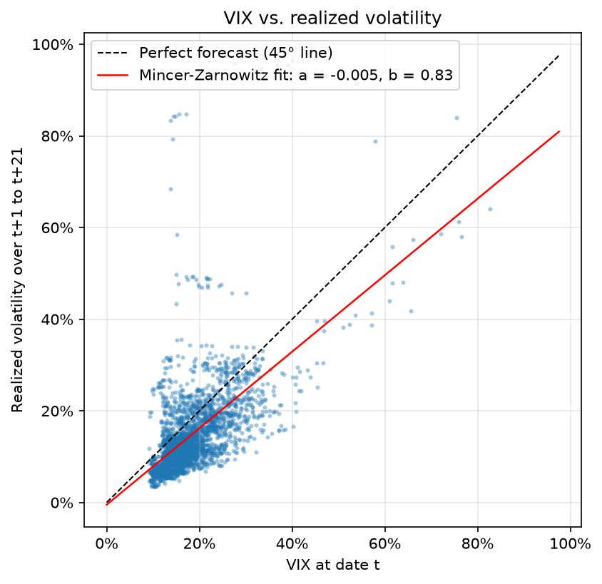
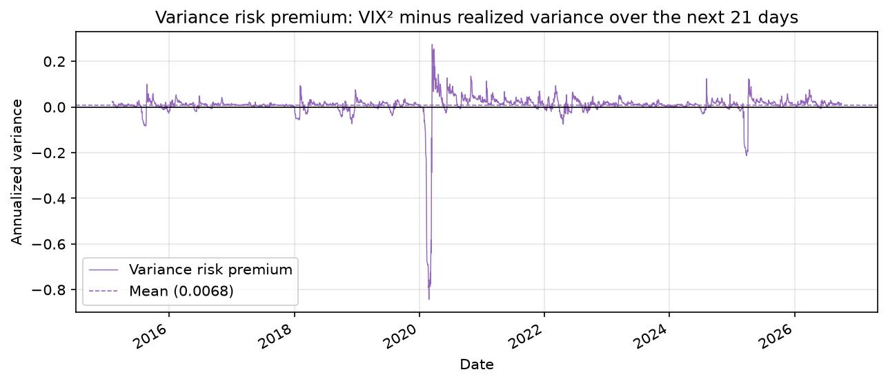

---

## Cross-cutting methodological notes

| Topic | Choice made in this project |
|---|---|
| **Look-ahead bias** | Every quantity used at date t is computed with data up to t−1 (`shift(1)`): standardized returns, rolling VaR, naive volatility forecast. Future realized volatility uses `shift(−21)` and is only ever a *target*. |
| **Rules fixed ex ante** | Drawdown thresholds (10%, 20%), windows (21 and 63 days), VaR levels (95%, 99%), backtest window (252 days) and HAC lags were set before looking at results. |
| **Overlapping observations** | Overlapping 21-day windows inflate apparent significance; handled with Newey-West standard errors and a non-overlapping monthly sample. |
| **Simple vs. log returns** | Log returns for statistics and volatility (additive over time); simple returns for performance and losses. |
| **Annualization** | 252 trading days; `√252` for volatility. Annualization assumes independent returns, which Block 3 shows is only approximately true. |
| **Validation** | The custom Ljung-Box implementation is checked against `statsmodels.stats.diagnostic.acorr_ljungbox`; the VIX is checked against three sources. |
| **Censoring** | Drawdown episodes not recovered at the end of the sample would be flagged rather than given a misleading duration. |
| **Testing language** | A p-value above 5% means "not rejected", not "accepted". |

---

## Limitations

- **One asset, one period.** Results describe the S&P 500 price index over 2015–2026, a sample dominated
  in its tails by a single extreme event (March 2020). They do not generalize automatically to other
  markets, asset classes or periods.
- **Price index, not total return.** Dividends are ignored, which understates returns and overstates
  drawdown durations.
- **Daily closes only.** Close-to-close volatility is a noisy estimate; intraday data would allow true
  realized volatility measures.
- **Simple volatility models.** Rolling windows react slowly and give equal weight to all days in the
  window. No conditional model (EWMA, GARCH) is estimated.
- **Unconditional backtest only.** The Kupiec test does not detect clustered exceedances.
- **Horizon mismatch.** The VIX covers 30 calendar days, about 21–22 trading days, not exactly 21.
- **Free data sources.** Yahoo Finance is not an official source; this project found and documented
  one incorrect VIX record.

---

## Possible extensions

- [ ] **Conditional volatility**: EWMA and GARCH(1,1) / GJR-GARCH, used to standardize returns and to
      compute a **filtered historical simulation** VaR.
- [ ] **Christoffersen (1998) independence and conditional coverage tests** for the VaR backtest.
- [ ] **Yang & Zhang (2000) volatility estimator**, which accounts for overnight jumps.
- [ ] **HAR model of realized volatility** (Corsi, 2009) and a GARCH forecast as extra benchmarks in Block 6.
- [ ] **Encompassing regression** combining the VIX and past volatility.
- [ ] **Total-return index** (dividends reinvested) to compare drawdowns and recovery times.
- [ ] **Cross-check of the S&P 500** against an independent source (FRED `SP500`).
- [ ] **Unit tests** (`tests/`) on toy series with known answers (drawdowns, VaR, Kupiec).

---

## References

**Returns and stylized facts**

- Booth, D. G., & Fama, E. F. (1992). Diversification returns and asset contributions.
  *Financial Analysts Journal*, 48(3), 26–32.
- Campbell, J. Y., Lo, A. W., & MacKinlay, A. C. (1997). *The Econometrics of Financial Markets*.
  Princeton University Press.
- Cont, R. (2001). Empirical properties of asset returns: Stylized facts and statistical issues.
  *Quantitative Finance*, 1(2), 223–236.
- Mandelbrot, B. (1963). The variation of certain speculative prices. *Journal of Business*, 36(4), 394–419.

**Volatility estimation and dynamics**

- Black, F. (1976). Studies of stock price volatility changes. *Proceedings of the 1976 Meetings of the
  American Statistical Association, Business and Economic Statistics Section*, 177–181.
- Bollerslev, T. (1986). Generalized autoregressive conditional heteroskedasticity.
  *Journal of Econometrics*, 31(3), 307–327.
- Christie, A. A. (1982). The stochastic behavior of common stock variances: Value, leverage and interest
  rate effects. *Journal of Financial Economics*, 10(4), 407–432.
- Corsi, F. (2009). A simple approximate long-memory model of realized volatility.
  *Journal of Financial Econometrics*, 7(2), 174–196.
- Ding, Z., Granger, C. W. J., & Engle, R. F. (1993). A long memory property of stock market returns and
  a new model. *Journal of Empirical Finance*, 1(1), 83–106.
- Engle, R. F. (1982). Autoregressive conditional heteroscedasticity with estimates of the variance of
  United Kingdom inflation. *Econometrica*, 50(4), 987–1007.
- Garman, M. B., & Klass, M. J. (1980). On the estimation of security price volatilities from historical
  data. *Journal of Business*, 53(1), 67–78.
- Parkinson, M. (1980). The extreme value method for estimating the variance of the rate of return.
  *Journal of Business*, 53(1), 61–65.
- Yang, D., & Zhang, Q. (2000). Drift-independent volatility estimation based on high, low, open, and
  close prices. *Journal of Business*, 73(3), 477–491.

**Statistical tests**

- Jarque, C. M., & Bera, A. K. (1980). Efficient tests for normality, homoscedasticity and serial
  independence of regression residuals. *Economics Letters*, 6(3), 255–259.
- Ljung, G. M., & Box, G. E. P. (1978). On a measure of lack of fit in time series models.
  *Biometrika*, 65(2), 297–303.
- Newey, W. K., & West, K. D. (1987). A simple, positive semi-definite, heteroskedasticity and
  autocorrelation consistent covariance matrix. *Econometrica*, 55(3), 703–708.

**Risk measures and backtesting**

- Artzner, P., Delbaen, F., Eber, J.-M., & Heath, D. (1999). Coherent measures of risk.
  *Mathematical Finance*, 9(3), 203–228.
- Basel Committee on Banking Supervision (2019). *Minimum capital requirements for market risk*.
  Bank for International Settlements.
- Christoffersen, P. F. (1998). Evaluating interval forecasts. *International Economic Review*, 39(4), 841–862.
- Kupiec, P. H. (1995). Techniques for verifying the accuracy of risk measurement models.
  *Journal of Derivatives*, 3(2), 73–84.

**Implied volatility and forecast evaluation**

- Bollerslev, T., Tauchen, G., & Zhou, H. (2009). Expected stock returns and variance risk premia.
  *Review of Financial Studies*, 22(11), 4463–4492.
- Carr, P., & Wu, L. (2009). Variance risk premiums. *Review of Financial Studies*, 22(3), 1311–1341.
- Mincer, J. A., & Zarnowitz, V. (1969). The evaluation of economic forecasts. In J. A. Mincer (Ed.),
  *Economic Forecasts and Expectations: Analysis of Forecasting Behavior and Performance* (pp. 3–46).
  National Bureau of Economic Research.

**Data and market structure**

- Cboe Exchange, Inc. (2022). Order granting approval of a proposed rule change to adopt a modified
  trading schedule for holidays (SR-CBOE-2021-068). U.S. Securities and Exchange Commission,
  Release No. 34-94253.
- Federal Reserve Bank of St. Louis. *CBOE Volatility Index: VIX (VIXCLS)*. FRED Economic Data.

---

## Author and disclaimer

**Ethan Serfati**, third-year student in Management (L3 Gestion, Finance track) at Université Paris 1
Panthéon-Sorbonne · GitHub: [ethn3srf](https://github.com/ethn3srf)

**Disclaimer.** This is an educational research project. Nothing in this repository is investment advice.
Market data belongs to its respective providers (Yahoo Finance, FRED, Cboe) and is not redistributed here.